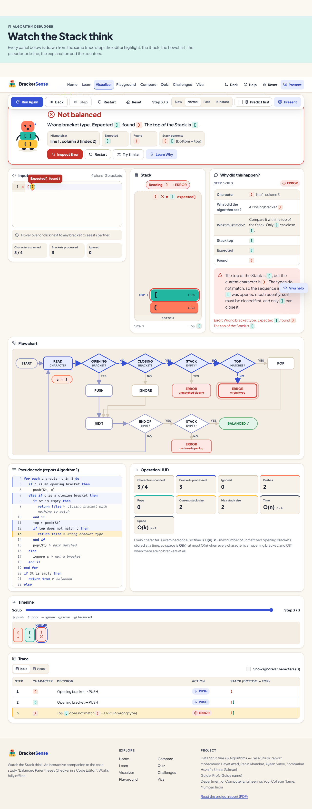

# BracketSense

**Learn • Visualize • Master Stacks.** BracketSense is an interactive learning platform that teaches how a
**Stack** solves the **balanced brackets** problem. It is the companion app to the Data Structures &
Algorithms case study *“Balanced Parentheses Checker in a Code Editor”* (`public/report/DSA_REPORT.pdf`).

> Watch the Stack think.



It is a mini-course, a step-by-step algorithm debugger, a sandbox, a quiz, challenges and viva prep in one
client-side web app. No backend, no account, works offline after the build.

| Page | What you can do |
| --- | --- |
| **Home** | Live Stack demo driven by the real engine, progress, concept checklist, achievements, “About this project” |
| **Learn** | 8 short lessons (What is a Stack → Practice), each with an interactive widget and a check question |
| **Visualizer** | Debugger for the algorithm: editor, Stack, flowchart, pseudocode, explanation, HUD, timeline and trace table all synced to one step. Prediction mode, result screen, “Visualize Nesting” code-folding demo, guided tour |
| **Playground** | Paste or upload code, share a link, matching-pair explorer, verified fix suggestions; **Break the Algorithm**; **Complexity Lab** |
| **Compare** | The same input through real Stack, Counter and Queue implementations on one scrubber |
| **Quiz** | 10 mixed questions per run (choice, click-the-failing-character, drag-to-order, fix-the-string, predict-the-stack), weak-concept report |
| **Challenges** | 14 challenges in 5 levels, stars, points, hints, “Learn from this mistake” |
| **Viva** | 23 exam-ready cards, search, categories, practice mode with self-rated confidence; also a slide-over on every page |
| **Presentation Mode** | Full-screen view for a projector with a 90-second Auto-Demo for evaluators |

## Quick start

Requirements: Node.js 20 or newer (built and tested with Node 23), npm. Google Chrome for the end-to-end tests.

```bash
npm install        # install dependencies
npm run dev        # start the dev server, open the printed URL
npm run build      # type-check and build into dist/
npm run preview    # serve the production build at http://localhost:4173
npm test           # unit tests (Vitest): 109 tests for the core and learning modules
npm run lint       # oxlint
npm run e2e        # Playwright: acceptance tests, screenshots, axe accessibility scans (42 tests)
```

`npm run e2e` builds the app and serves it automatically; it drives your installed Chrome
(`channel: 'chrome'`), so no browser download is needed.

The build uses relative paths and a hash router, so `dist/` works from any folder or sub-path,
including GitHub Pages: publish the contents of `dist/`.

## Make it yours

| What | Where |
| --- | --- |
| Students, guide, department, college, year | `src/config/project.ts` (one file; empty strings are hidden) |
| Pictures (logo, hero, mascot, lesson headers, badges, team photo) | Drop files into `public/assets/` named after the slot, see [ASSETS.md](ASSETS.md) |
| Browser-tab icon | `public/favicon.svg` |
| The report PDF linked from the app | `public/report/DSA_REPORT.pdf` |

> The guide and college fields are placeholders (`Prof. (Guide name)`, `Your College Name`). Please fill them in.

## Folder map

```
src/
  core/              pure TypeScript, no UI: the algorithm and everything computed from it
    Stack.ts           linked-list Stack with O(1) push/pop/peek and O(1) immutable snapshots
    Queue.ts           real FIFO queue (for the comparisons)
    bracketRules.ts    pairs, isOpening, isClosing, matches, colour families
    validator.ts       THE algorithm (report Algorithm 1), with an observer hook
    traceEngine.ts     one frozen snapshot per character + end of input, WHY-style explanations
    matcher.ts         bracket-pair map for hover/click matching
    alternatives.ts    Counter, Queue and broken variants, divergence finder
    complexity.ts      operation counting, generated inputs, stack heights
    fixes.ts           fix suggestions, each verified by re-running the validator
    generators.ts      seeded random inputs, “Try Similar”
    flow.ts / pseudocode.ts / messages.ts / position.ts / types.ts
  learning/          course content and progress (no UI)
    lessons.ts, quiz.ts, challenges.ts, viva.ts, variants.ts, examples.ts,
    achievements.ts, concepts.ts, progress.ts (versioned localStorage), storage.ts
  components/        UI building blocks (editor, StackView, Flowchart, panels, widgets, charts…)
  pages/             Home, Learn, Visualizer, Playground, Compare, Quiz, Challenges, Viva
  app/               shell, providers (settings, progress, toasts, announcer), dialogs, Presentation Mode
  config/            project.ts (student details), assets.ts (image slots)
  theme/             design tokens (light + dark) and base styles
build/studentAssets.ts   Vite plugin that discovers pictures in public/assets
tests/                   Vitest unit tests
e2e/                     Playwright acceptance, screenshot and accessibility tests
docs/screenshots/        screenshots produced by the e2e run
```

## How it works

**One algorithm, one source of truth.** The balanced-brackets algorithm exists exactly once, in
`core/validator.ts`. The trace engine does not re-implement it: it records the validator's steps through an
observer. Every Visualizer panel renders `trace.steps[currentStepIndex]`, so forward, back, jump, timeline,
table and animations can never disagree.

**Real Stack, cheap snapshots.** The Stack is a linked list whose nodes are immutable, so taking a snapshot is
O(1) (a pointer to the top node). A 10 000-character input produces 10 001 snapshots in linear time and memory,
and stepping back simply reads an earlier snapshot. Long traces are rendered with a windowed list (only visible
timeline chips and table rows exist in the DOM).

**Nothing is faked.** Stack pictures come from real snapshots, Compare runs real Counter and Queue
implementations, quiz and challenge answers are computed by the engine, and the Complexity Lab charts real
operation counts.

## Algorithm notes (from the report)

```
for each character c:
    if c is opening: push c
    else if c is closing:
        if the stack is empty: reject   (unmatched closing bracket)
        if the top does not match c: reject   (wrong bracket type)
        pop
    else: ignore c
after the loop: the stack is empty ? accept : reject   (unclosed opening brackets)
```

- **Peek before pop.** The report's Algorithm 1 pops the top and then compares (`top ← pop(St)`), while its
  section 6.1 says the checker “calls peek() to check the top element and pop() to remove it if it matches”.
  BracketSense follows section 6.1 (peek, compare, then pop). The verdict is identical; peeking keeps the
  mismatched top visible on the Stack when a wrong-type error is shown. The pseudocode panel shows this version,
  with the report's line structure.
- **Ignored characters.** The report's problem statement uses only bracket characters; its section 8 example
  (`a[i] = (b + c) * {d - e}`) shows that other characters are skipped. The app makes that branch explicit
  (`ignore c`) and counts ignored characters.
- **Errors.** Three distinct messages: *Wrong bracket type. Expected `]`, found `)`. The top of the Stack is `[`.*
  · *Unmatched closing bracket. The Stack is empty, so there is nothing to match this character.* ·
  *Unclosed opening brackets. N bracket(s) remain in the Stack.* The scan stops at the first error, as in the report.
- **Complexity.** Time O(n). Space O(n) worst case (all openers) and O(1) best case (no brackets), as in report
  section 7.2; the app also states it as O(k), k = the most unmatched openers stored at once.
- **Empty input** is balanced (“Nothing to check”).

## Acceptance tests (SPEC section 7)

| # | Check | How it is verified |
| --- | --- | --- |
| 1 | `{[()]}` balanced, every push/pop | `tests/traceEngine.test.ts`, `e2e/acceptance.spec.ts` |
| 2 | `([)]` fails at `)` with WRONG_TYPE | unit + e2e (message, position, red underline, tooltip) |
| 3 | `((` UNCLOSED_OPENING, 2 remain | unit + e2e |
| 4 | `))` UNMATCHED_CLOSING at the first `)` | unit + e2e |
| 5 | `a[i] = (b + c) * {d - e}` balanced, 18 ignored | unit + e2e |
| 6 | Step forward/back restores every panel | e2e compares the text of all panels before and after |
| 7 | Wrong prediction lands on the failing step | e2e |
| 8 | Compare on `([)]`: Stack right, Counter and Queue wrong | `tests/alternatives.test.ts` + e2e |
| 9 | Quiz scoring and best-score persistence | `tests/progress.test.ts` + e2e (reload) |
| 10 | Light and dark fully readable | screenshots in `docs/screenshots/`, axe colour-contrast scans of every page in both themes |
| 11 | Refresh keeps progress, theme and last input | e2e |
| 12 | Desktop / tablet / mobile layouts | screenshots at 1280, 768 and 360 px; e2e fails on horizontal overflow |
| 13 | All SPEC section 2 edge cases | `tests/validator.test.ts`, `tests/traceEngine.test.ts` |
| 14 | Lighthouse accessibility ≥ 90 on Home and Visualizer | Lighthouse 12: **100** on both (best practices 100); axe WCAG 2.1 AA: 0 violations on 12 pages × 2 themes |

## Demo script for evaluators (about 5 minutes)

1. **Home** (30 s). Point at the live Stack in the hero: it is the real engine looping `{[()]}`. Scroll to
   “About this project” for the report, team and complexity summary.
2. **Visualizer** (90 s). Click **Run Trace ▶**, predict *Balanced*, and watch: the current character in the
   editor, the Stack, the glowing flowchart node, the pseudocode line, the explanation and the counters move
   together. Press **←** to step back: everything returns exactly. Click **Visualize Nesting** on the result.
3. **A failure** (45 s). Click *Try a failing one: `([)]`*. Predict *Balanced* (wrong on purpose): the app lands
   on the failing step, underlines `)` in red with “Expected ], found )” and explains why.
4. **Compare** (45 s). On `([)]`, step through: the Stack rejects at `)`, the Counter (1, 2, 1, 0) and the Queue
   wrongly say balanced. Load `{[()]}` to show the Queue rejecting a valid string.
5. **Playground** (45 s). *Break the Algorithm* → *Ignore bracket types*: see the exact divergence step and the
   rule it protects. *Complexity Lab* → *Run measurement*: operations ≈ 2.5 × n, a straight line.
6. **Learn / Quiz / Challenges / Viva** (30 s). Open Lesson 1's real Stack widget, a quiz question with its stack
   picture, and the Viva helper's “Explain your project in 30 seconds” card.
7. **Presentation Mode** (optional). Top bar → **Present** → **Auto-Demo (90 s)** runs the whole story
   hands-free. **Esc** exits.

Keyboard: **Space** play/pause, **→ / ←** step, **R** reset, **P** Presentation Mode, **?** help.

## Accessibility and responsiveness

Keyboard access everywhere with visible focus, ARIA live announcements for every step (“Step 3: pushed (.
Stack size 3.”), status shown with icons and text (never colour alone), WCAG AA contrast in both themes,
`prefers-reduced-motion` respected, and the theme follows the OS on first visit, then remembers your choice.
Layouts: desktop IDE grid, stacked tablet layout, real tabs plus a thumb-reach control bar on phones.

## Notes and assumptions

- The brief asked for “the six required questions from the original spec” in the quiz, but those questions were
  not included. The six core questions (always in every run) cover the topics the spec lists: balanced?, Stack
  top, what happens on a character, first failing character, time complexity, and why a Stack.
- No pictures were supplied, so the report's two figures are used as the project's own diagrams and the
  other slots use drawn SVG fallbacks (see [ASSETS.md](ASSETS.md)).
- Progress is stored in this browser only (`localStorage`, versioned). Help → *Export progress* saves a JSON
  file that can be imported elsewhere.

## Credits

Case study report by Mohammed Hayat Azad, Rahin Khamkar, Ayaan Surve, Zombarkar Huzaifa and Umair Salmani,
Department of Computer Engineering, Mumbai. References: Cormen et al., *Introduction to Algorithms*; Weiss,
*Data Structures and Algorithm Analysis*; GeeksforGeeks, *Check for Balanced Parentheses*; Visual Studio Code
documentation, *Bracket Pair Colorization*.
